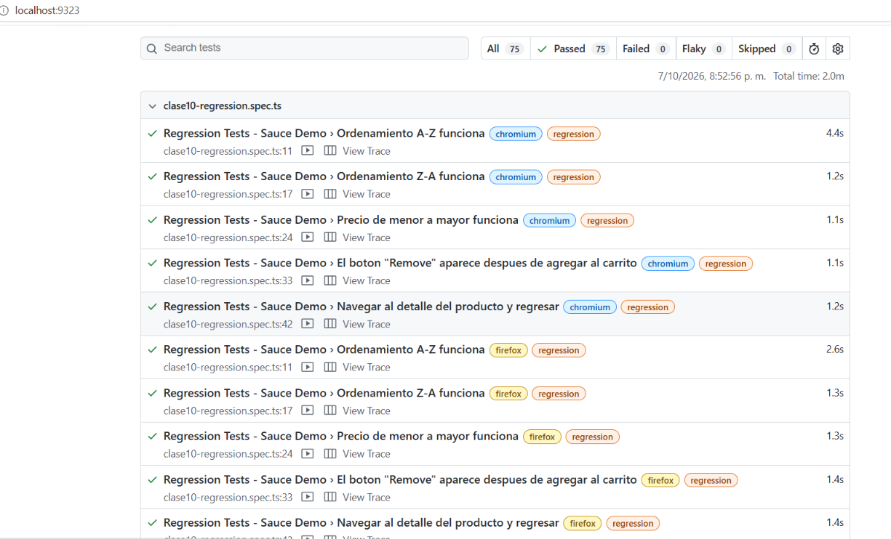

## Clase 10 — Multi-browser y Tags (cómo ejecutar)

### Requisitos
- Node.js 18 o superior
- Instalación (una sola vez):
  ```powershell
  npm install
  npx playwright install
  ```
  `npx playwright install` descarga Chromium, Firefox y WebKit (necesarios para los 5 projects).

### Archivos de esta clase
| Archivo | Qué contiene |
|---|---|
| `playwright.config.ts` | 5 projects: chromium, firefox, webkit, mobile-chrome (Pixel 5), mobile-safari (iPhone 12) y `workers: 1` |
| `tests/clase10-smoke.spec.ts` | 5 tests `@smoke` |
| `tests/clase10-regression.spec.ts` | 5 tests `@regression` |
| `tests/tarea10.spec.ts` | 3 retos: tags múltiples, `expect.soft()` y fixture `browserName` |
| `evidencias/tarea10/` | Capturas por project y screenshot del reporte HTML multi-browser |

### Ejecución completa (5 projects)
```powershell
npx playwright test tests/clase10-smoke.spec.ts tests/clase10-regression.spec.ts tests/tarea10.spec.ts
npx playwright show-report
```
Total esperado: 15 tests x 5 projects = **75 tests** (5 smoke + 5 regression + 5 de la tarea, por cada project).

### Ejecución selectiva por tags
```powershell
npx playwright test --grep "@smoke"
npx playwright test --grep "@regression"
npx playwright test --grep "@regression" --grep-invert "@ui"   
npx playwright test --grep-invert "@ui"                         
```

### Ejecución selectiva por navegador
```powershell
npx playwright test --project=firefox
npx playwright test --project=webkit
npx playwright test --project=mobile-chrome --grep "@smoke"
```

### Retos de la tarea (`tests/tarea10.spec.ts`)
1. **Tags múltiples + `--grep-invert`**: tests con `{ tag: ['@regression', '@ui'] }`; se excluyen con `--grep-invert "@ui"`.
2. **`expect.soft()`**: verifica 5 atributos del primer producto sin detenerse en la primera falla; `testInfo.errors` los reporta juntos.
3. **Fixture `browserName`**: la aserción del user agent cambia según el motor real (chromium / firefox / webkit) en lugar de usar `test.skip()`.

### Evidencias
- Capturas de cada reto en `evidencias/tarea10/`.
- Reporte HTML multi-browser: `evidencias/tarea10/reporte-html-multibrowser.png`.

